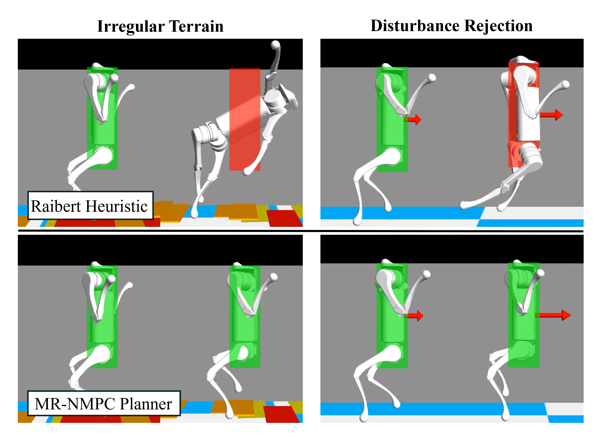
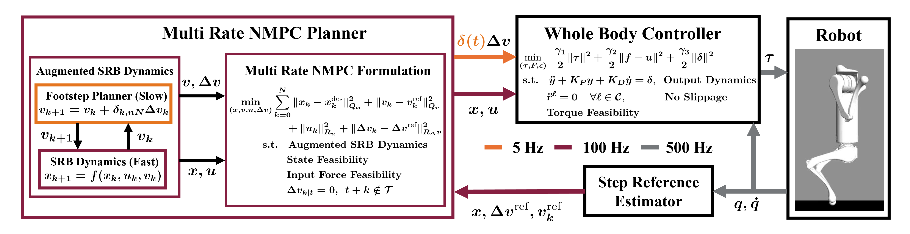
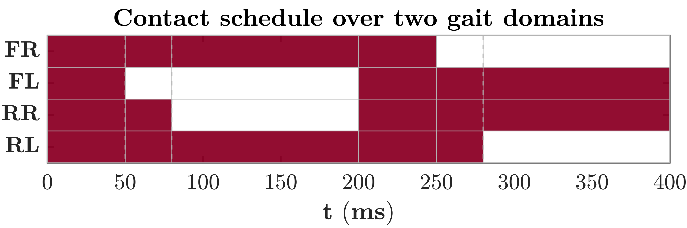
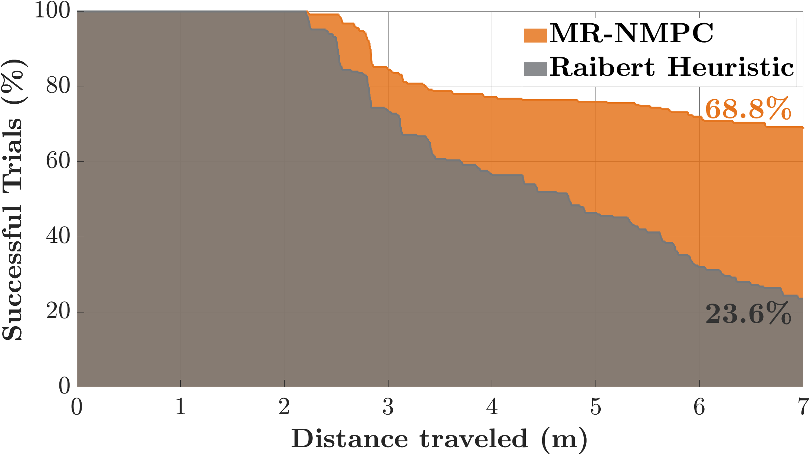

**IEEE/RSJ IROS 2026** · T. Chunawala, J. Kim, K. Akbari Hamed

<a href="https://www.youtube.com/watch?v=N6XwNJ0E9s0" class="btn btn--primary">▶ Watch the Video</a> <a href="https://arxiv.org/abs/2607.01574" class="btn btn--inverse">📄 Read the Paper (arXiv)</a>

This project lets a quadrupedal robot walk upright on its rear legs while bracing its front legs against nearby walls, for tight corridors and cluttered spaces. A **multi-rate nonlinear MPC (MR-NMPC)** plans the slow-updating footstep locations and the fast-updating body trajectory **together in one optimization**, instead of relying on a heuristic foot-placement rule.

  
  
<em>Simulation (Unitree A1). Top: with Raibert-heuristic foot placement, the robot leaves the safety envelope (red) on irregular terrain and under an external push. Bottom: with the MR-NMPC planner, it stays within the envelope (green).</em>

---

## Problem

- An upright, wall-supported posture is **underactuated, hybrid and dynamically unstable**, with brief, small-area contacts.
- Body motion, contact forces and foot placement are **strongly coupled**, and they evolve at different rates.
- Standard MPC assumes uniform input rates and usually places feet with a **heuristic** (such as the Raibert rule), which breaks down on irregular terrain at higher speeds.

---

## Approach

  
  
<em>Layered control architecture. The multi-rate NMPC planner (100 Hz) contains a slow footstep planner and the fast SRB dynamics; footstep updates δ(t)Δv are applied only at switching instants. A whole-body controller tracks the plan using the full-order dynamics.</em>

- **Multi-Rate NMPC (High Level):** Plans footstep locations together with the center-of-mass and orientation trajectories, using a single-rigid-body (SRB) model with contact constraints.
- **Multi-Rate Formulation:** Footstep locations are added to the state, and their updates are gated by an indicator function that is nonzero only at contact-switching instants. This lets one optimization handle slow footstep decisions (5 Hz) alongside fast body-motion and contact-force updates (100 Hz), without a separate footstep planner.
- **Foothold Propagation:** Future footholds are part of the prediction dynamics, so the controller can choose **asymmetric front and rear step lengths** to keep balance.
- **Whole-Body Controller (Low Level):** A nonlinear QP controller based on virtual constraints tracks the MPC references using the full-order robot dynamics.

- **Wall-Supported Gait:** Each gait domain cycles through four-, three- and two-contact phases, with the front feet bracing against the wall.

  
  
<em>Contact schedule over two gait domains (filled = foot in contact). Each 200 ms domain moves from four contacts (50 ms) to three (30 ms) to two (120 ms), alternating sides.</em>

<table style="display: table; width: auto; margin-left: auto; margin-right: auto;">
  <thead>
    <tr><th>Parameter</th><th>Value</th></tr>
  </thead>
  <tbody>
    <tr><td>High-Level MR-NMPC Rate</td><td><strong>100 Hz</strong></td></tr>
    <tr><td>Footstep Update Rate</td><td><strong>5 Hz</strong> (once per gait domain)</td></tr>
    <tr><td>Prediction Horizon</td><td>20 steps (200 ms)</td></tr>
    <tr><td>Mean Solve Time</td><td><strong>8.26 ms</strong></td></tr>
    <tr><td>Solver</td><td>CasADi / IPOPT</td></tr>
    <tr><td>Low-Level Whole-Body Controller Rate</td><td><strong>1 kHz</strong></td></tr>
    <tr><td>Simulation Platform</td><td>Unitree A1 in RaiSim</td></tr>
    <tr><td>Hardware Platform</td><td>Unitree Go2 (Preliminary)</td></tr>
  </tbody>
</table>

---

## Results

**Simulation (Unitree A1)**
- **2.9× higher success rate** than MPC with Raibert-heuristic foot placement: **68.8% vs. 23.6%** across **250 randomized 7 m tracks** with random wooden-block terrain, with speeds ramped up to 0.8 m/s.

  
  
<em>Share of 250 randomized trials still successful versus distance traveled. Both controllers perform similarly for the first 2 m; as speed increases, the Raibert heuristic fails more often, while MR-NMPC keeps 68.8% of trials successful at 7 m.</em>

- Rejects a **50 N** sinusoidal push while staying within safety and kinematic limits, by choosing shorter, asymmetric steps where the heuristic over-steps.

**Preliminary Hardware (Unitree Go2)**
- **Real-Time Deployment:** The robot moves from a crouch to **upright wall-supported bipedal locomotion** and keeps its balance for **over 60 s**.
- **State Estimation:** A dedicated estimator reduced noise in the velocity estimates, which was critical for getting the Go2 to stand and balance upright.
- **Next Step:** Wall-supported bipedal walking over uneven terrain on the Go2 hardware.

  

    

      
    

    
<em>Simulation: Unitree A1 on randomized wooden-block terrain.</em>

  

  

    

      
    

    
<em>Hardware: Unitree Go2 in wall-supported bipedal locomotion.</em>

  

---

## What I Built

- The MR-NMPC formulation and its CasADi/IPOPT implementation
- A multithreaded real-time C++ control stack linking the NMPC to the whole-body controller
- A 1 kHz kinematics–IMU state estimator that reduced velocity-estimation noise, enabling upright balance on hardware
- The randomized-terrain benchmark against the Raibert heuristic

---

## Related Project

- [Robust MPC for a Tremor-Suppression Exoskeleton](/rmpc-exoskeleton.html)
