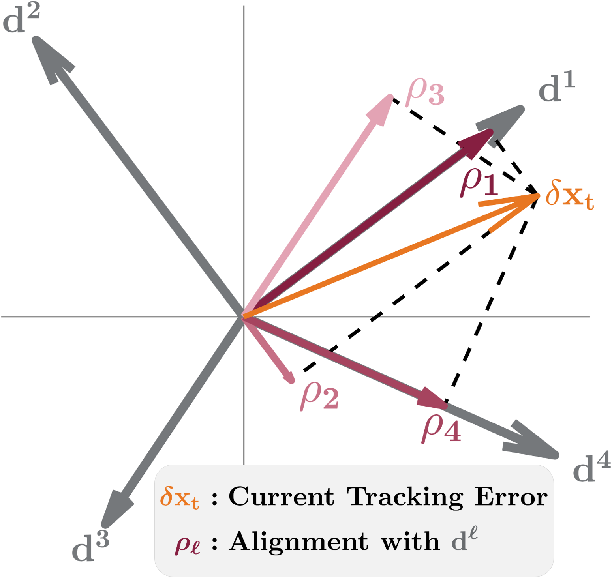
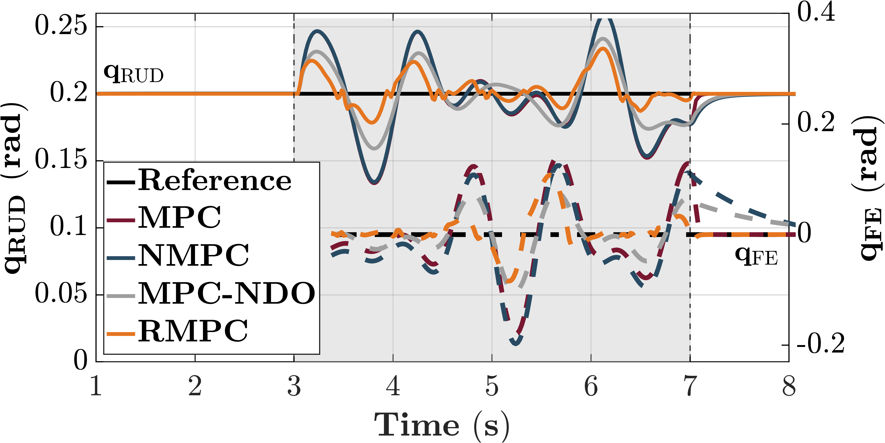
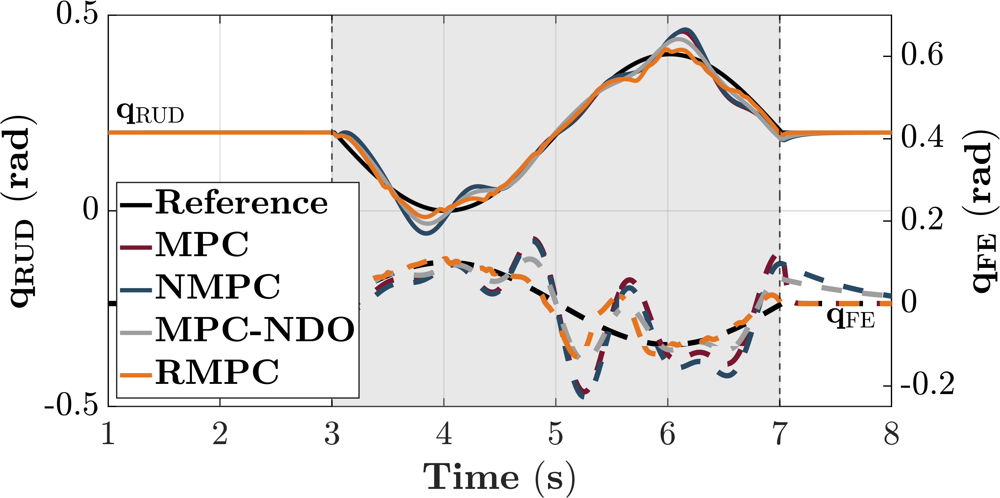

**ASME Journal of Dynamic Systems, Measurement, and Control** (accepted, in press) · T. Chunawala, S. Janakaraj, J. Decker, M. Ahmad, S. Vijayan, O. Barry, K. Akbari Hamed  
🎥 [Video](https://www.youtube.com/watch?v=X2gqHbkB6GM) · 📄 Paper link coming soon

This project develops a **robust model predictive controller (RMPC)** for the **Tremor Alleviating Wrist Exoskeleton (TAWE)**. It suppresses essential-tremor motion while preserving voluntary wrist movement. Instead of reacting to tremor after it happens, the controller **plans in advance for the worst-case tremor disturbances**.

> All controller results are from **simulation**. The tremor data used to build and test the controller was **recorded from essential-tremor patients** wearing TAWE.

---

## System

- **Device:** TAWE, a 6-DoF passive linkage with **2 actuated joints**: wrist flexion/extension (FE, up-down) and radial/ulnar deviation (RUD, side-to-side)
- **Model:** The 9-DoF arm–exoskeleton system, reduced through its holonomic constraints to a 2-DoF wrist model for real-time control
- **Tremor Data:** Recorded in an IRB-approved study with **3 essential-tremor participants and 3 healthy controls**. TAWE logged wrist motion in passive mode alongside **EEG and EMG** during standard clinical tasks (arm extension, nose touching, Archimedes spiral). ET participants show distinct power peaks in the **4–12 Hz** band.

  
  
<em>The Tremor Alleviating Wrist Exoskeleton (TAWE).</em>

---

## Approach

- **One Branch per Extreme Disturbance:** Tremor torque is mapped to joint-velocity deviations, and a **convex hull with 4 vertices** bounds them. The RMPC predicts one branch for each vertex, with its own cost and constraints.
- **One Combined Optimization:** Branch costs are summed and constraints are stacked, and all branches **share the same first control input**, which is the action applied now.
- **Real-Time:** 20 ms sampling, prediction horizon N = 15, mean solve time **14.6 ms** (MATLAB, desktop).
- **Four Vertices:** Compared with 5 or 6 vertices, 4 gave the lowest side-to-side error (**0.010 vs. 0.033 rad**) with similar up-down error, and solved faster (more vertices took 16–17 ms).

---

## Key Contribution: State-Dependent Cost Weighting

Standard robust MPC weights every disturbance branch equally, so it guards against all four extremes at once and reacts sluggishly. This controller instead weights each branch by how closely its disturbance aligns with the **current tracking error**, so it **prioritizes the tremor currently pushing the wrist off course**.

For each branch ℓ, an alignment score ρℓ compares the tracking error δxt with the disturbance direction dℓ. The scores are normalized into weights wℓ = ρℓ / (ρ1 + … + ρ4), and the controller minimizes the weighted cost **Jtot = w1J1 + w2J2 + w3J3 + w4J4**.

  
  
<em>Grey arrows: the four extreme disturbances d1–d4. Orange: the current tracking error δxt. Each ρℓ measures how well the error aligns with dℓ. Here the error points almost along d1, so that branch gets the largest weight, while d2, pointing the opposite way, gets the smallest.</em>

---

## Results (Simulation)

**Benchmark Tremor** (amplitude-modulated sinusoids, 3–7 Hz, applied between 3 and 7 s). Solid lines show side-to-side (RUD) motion and dashed lines up-down (FE) motion.

  

    
    
<em>Constant reference</em>

  

  

    
    
<em>Time-varying reference</em>

  

<em>Tracking error, RMSE in rad (lower is better)</em>

<table style="display: table; width: auto; margin-left: auto; margin-right: auto;">
  <thead>
    <tr><th>Joint</th><th>MPC</th><th>NMPC</th><th>MPC-NDO</th><th><strong>RMPC</strong></th></tr>
  </thead>
  <tbody>
    <tr><td>Side-to-side (RUD)</td><td>0.031</td><td>0.030</td><td>0.015</td><td><strong>0.010</strong></td></tr>
    <tr><td>Up-down (FE)</td><td>0.072</td><td>0.074</td><td>0.035</td><td><strong>0.028</strong></td></tr>
  </tbody>
</table>

RMPC has **20–33% lower error** than MPC-NDO, an MPC augmented with a nonlinear disturbance observer and the strongest baseline.

**Why It Wins:** MPC-NDO's observer underestimates peak tremor torque and lags behind it. RMPC instead applies faster, more aggressive torque corrections ("active stiffness"), trading a smoother control input for tighter tracking.

**Stress Tests** versus MPC-NDO:
- **Sensor Noise (0.01 rad):** MPC-NDO amplifies noise; RMPC has **up to 46% lower** error.
- **50% Actuation Latency:** Both controllers perform comparably.

**Patient-Derived Tremor:** RMPC cuts tracking error by **up to 47%** versus MPC-NDO (RMSE 0.015 / 0.032 vs. 0.024 / 0.060 rad).

**Next Step:** Integrate the RMPC on the TAWE prototype for clinical trials, and tailor the uncertainty set to each patient's tremor profile, with learning-based adaptation as a future extension.

---

## What I Built

- The reduced-order wrist model and the RMPC formulation with state-dependent cost weighting
- The data-driven convex uncertainty set derived from tremor torques
- The benchmark against MPC, NMPC and MPC-NDO, including noise, latency and patient-data stress tests

---

## Related Project

- [Multi-Rate NMPC for Wall-Supported Bipedal Locomotion](/bipedal-mr-nmpc5.html)
